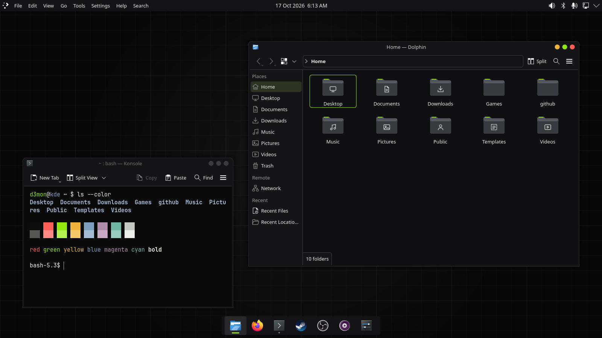
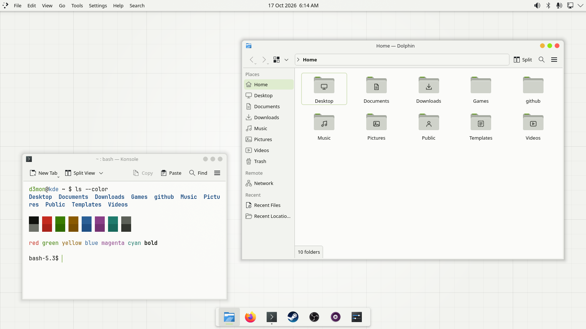

# d3mon-kde

One script to restore my usual apps on Arch Linux + KDE Plasma 6 and
apply the **d3mon** theme: a flat, near-black (or light) look with a
green accent, custom folder icons and round window buttons, across
Plasma, Dolphin, Konsole, Kitty and GTK apps. Inspired by the
Dracula KDE theme.

KDE itself is not installed here; pick KDE Plasma in `archinstall`.




These are real screenshots of a nested Plasma 6.7 session
(`tools/screenshot.sh`). The top bar + dock layout is optional
(`--layout`).

## Use

```sh
git clone https://github.com/uhd3mon/d3mon-kde.git
cd d3mon-kde
./install.sh            # dry run: prints the plan, changes nothing
./install.sh --apply    # install apps + theme (dark)
```

Options:

- `--theme light` for d3mon Light
- `--layout` to also replace your panels with the top bar + floating
  dock (off by default, it resets your panel setup)
- `--skip-packages`, `--skip-steam`, `--skip-aur`, `--skip-theme`
- `--remove-hyprland` removes the old hyprd3mon Hyprland setup
  (see below)

## Apps

From `packages/pacman.txt` (add your own, one per line): Steam
(+ the lib32 Vulkan driver for your GPU, needs `[multilib]`), MPV,
Kitty, OBS Studio + browser plugin, JetBrains Mono Nerd Font.
From the AUR via `yay` (`packages/aur.txt`): obs-vkcapture
(+ lib32) for OBS game capture.

## Theme

- **Global Themes** "d3mon Dark" and "d3mon Light" in
  System Settings → Colors & Themes → Global Theme
- **Colours** D3monDark / D3monLight (KDE apps and GTK apps)
- **Icons** d3mon / d3mon Light: folder icons, the rest is Breeze
- **Plasma Style** d3mon: dock with an accent underline
- **Window decoration** d3mon / d3mon Light: round buttons
- **Wallpaper** d3mon Grid (dark and light)
- **Konsole** profiles "d3mon" / "d3mon-light"
- **Kitty** follows Plasma light/dark by itself
- **MPV** OSD in d3mon colours

After installing, you can switch between dark and light at any time
in System Settings → Global Theme.

### Install without the script

Every part also installs through KDE's own settings pages. Build the
packages (or download them from the GitHub release):

```sh
tools/package.sh        # writes dist/
```

| File | Where in System Settings |
| --- | --- |
| `d3mon-*.globaltheme.tar.gz` | Global Theme → Install from File |
| `d3mon.plasmastyle.tar.gz` | Plasma Style → Install from File |
| `d3mon-icons.tar.gz` | Icons → Install from File |
| `D3mon*.colors` | Colors → Install from File |

Window decorations and the wallpaper have no "Install from File"
button:

```sh
kpackagetool6 -t KWin/Aurorae -i d3mon.aurorae.tar.gz
tar -C ~/.local/share/wallpapers -xzf d3mon-grid.wallpaper.tar.gz
```

Konsole schemes (`*.colorscheme`) go in `~/.local/share/konsole/`.
A Global Theme carries its own colours. If the icons, style or
decoration are missing, it uses Breeze for those parts.

## Removing the old Hyprland setup

```sh
./install.sh --remove-hyprland            # dry run
./install.sh --remove-hyprland --apply
```

Run it from a KDE session. It uninstalls hyprland, hyprlock,
hyprpaper, hyprshot, hyprshutdown, hyprpolkitagent, hyprpicker,
xdg-desktop-portal-hyprland, waybar, rofi and mako (whichever are
installed; pacman asks first). It moves hyprd3mon's files to
`~/.local/state/d3mon-kde/backup/`. Firefox, OBS, Steam, Kitty and
Nautilus stay installed.

## Safety

- The dry run is the default.
- Changed files are backed up first, to
  `~/.local/state/d3mon-kde/backup/<time>/`.
- Re-running only updates what changed.
- Everything except packages installs to your home folder.

## Layout

- `install.sh`, `packages/`
- `theme/`: color-schemes, icons, plasma, aurorae, look-and-feel,
  konsole, wallpapers
- `configs/`: kitty, mpv
- `tools/`: `package.sh`, `screenshot.sh`, `gen/` (icon,
  decoration, dock and wallpaper generators)
